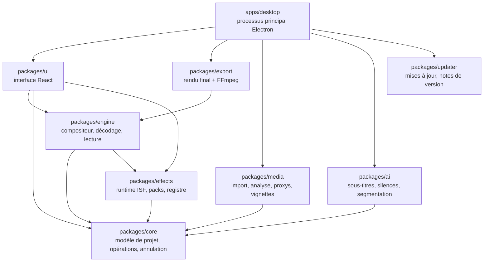
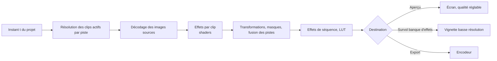

# 02 — Architecture

> Architecture cible, validée par [ADR-0001](adr/0001-stack-technique.md) sous condition des prototypes R1 à R5. Rien n'est implémenté.

## Stack proposée

| Couche | Choix | Raison |
|---|---|---|
| Coque applicative | Electron | Version de Chromium maîtrisée, accès Node pour FFmpeg et les fichiers, mise à jour via GitHub Releases déjà outillée |
| Interface | TypeScript, React, état centralisé (Zustand) | Itération rapide sur l'UI, thèmes clair/sombre et animations simples à faire |
| Moteur de rendu | WebGL2, migration WebGPU envisagée | Les effets communautaires open source sont écrits en GLSL (voir [04](04-banque-effets.md)) : ils tournent tels quels |
| Décodage pour l'aperçu | WebCodecs, avec proxys générés par FFmpeg en repli | Décodage matériel, accès image par image |
| Import, analyse, proxys, export | FFmpeg et ffprobe en processus séparés | Tous les formats et encodeurs, y compris NVENC, AMF, QSV |
| Audio | Web Audio pour l'aperçu, FFmpeg pour le mixage final | À confirmer par prototype : la parité aperçu/export audio est un risque |
| IA locale | whisper.cpp (sous-titres), Silero VAD (silences), ONNX Runtime (segmentation) | Tout tourne sur la machine, sans service en ligne |
| Mise à jour | electron-updater sur GitHub Releases | Détection, téléchargement, installation en un clic |

Alternatives étudiées et écartées : voir l'ADR.

## Découpage en modules

Dépôt unique (monorepo), un paquet par responsabilité. Les dépendances vont toujours du haut vers le bas.

| Module | Responsabilité | Règle |
|---|---|---|
| `core` | Modèle de données du projet, opérations de montage, annuler/rétablir, sérialisation | TypeScript pur, aucune dépendance à l'interface ni à Electron ; testable entièrement en unitaire |
| `engine` | Calcule l'image et le son à un instant donné du projet | Ne connaît pas l'interface ; même code pour l'aperçu et l'export |
| `effects` | Charge, valide et exécute les effets, transitions et LUT ; gère le registre communautaire | Un effet est une donnée (shader + manifeste), jamais du code exécutable arbitraire |
| `media` | Import, lecture des métadonnées, proxys, vignettes, formes d'onde | Travaux en arrière-plan, annulables |
| `export` | Pilote le rendu image par image et l'encodage | Détecte les encodeurs matériels disponibles |
| `ai` | Fonctions IA locales | Modèles téléchargés à la demande, jamais inclus dans l'installateur |
| `updater` | Vérification, téléchargement, affichage des notes de version | |
| `ui` | Panneaux, timeline, inspecteur, thèmes | Ne modifie le projet qu'à travers les opérations de `core` |
| `desktop` | Fenêtres, menus, accès fichiers, lancement des processus | Seul module à parler au système |

### État réel en 0.1

Le code tient pour l'instant dans un seul paquet : les modules ci-dessus sont des dossiers de `src/` (`core`, `engine`, `effects`, `export`, `ui`, `desktop`) et `electron/` joue le rôle de `apps/desktop`. Le sens des dépendances est respecté ; le découpage en paquets séparés se fera quand un second consommateur le justifiera. L'import et les vignettes sont dans `ui/media.ts`, la mise à jour dans `electron/main.cjs` ; `ai` n'existe pas encore.

Pistes : cinq pistes de base (`text`, `overlay`, `video`, `sound`, `audio`), champs du projet, auxquelles l'utilisateur ajoute jusqu'à douze pistes libres nommées `<genre>-<numéro>` et rangées dans `extra` ; `order` donne toutes les pistes de haut en bas, l'image au-dessus de `video`, le son en dessous. Le code passe par `clipsOf` et `trackIds`, jamais par un champ du projet indexé par piste. Détail et raisons : [ADR-0004](adr/0004-pistes-dynamiques.md).

Composition : la piste principale (magnétique, avec transitions) est rendue d'abord, puis chaque incrustation et chaque titre est posé par-dessus, de la piste d'image la plus basse à la plus haute, avec son opacité et son mode de fusion, en alpha prémultiplié. Les titres sont dessinés sur un canvas 2D à la résolution du rendu, puis traités comme une image.

Écarts connus avec la cible : le temps est encore stocké en secondes flottantes et non en entiers ; l'aperçu décode avec les éléments vidéo du navigateur et non WebCodecs ; les transitions figent une image au lieu de faire se chevaucher les clips.

Premières mesures sur les risques, sur la machine de développement (GPU NVIDIA) : R1 (débit d'export) — environ 35 à 45 images par seconde en 720p et 25 en 1080p ; le rendu et le transfert des images limitent le débit, pas l'encodeur. R4 (aperçu au survol) — fonctionne sur toute la banque avec un seul contexte graphique, délai non mesuré. R2, R3 et R5 ne sont pas mesurés.

## Modèle de projet

- Fichier `.ezcut` : JSON avec numéro de version de schéma et migrations entre versions.
- Hiérarchie : Projet → Séquence → Pistes → Clips → Effets → Paramètres → Images clés.
- Les médias sont référencés par chemin et empreinte ; un média déplacé peut être relié à nouveau.
- Le temps est stocké en entiers (unités fixes par seconde), jamais en nombres flottants, pour éviter les décalages cumulés.
- Toute modification passe par une opération nommée et réversible (scinder, déplacer, modifier un paramètre). C'est ce qui donne l'annulation illimitée, la sauvegarde automatique et, plus tard, les préréglages et les macros.

## Pipeline de rendu

Un seul compositeur sert trois destinations. C'est ce qui garantit que l'aperçu, la vignette au survol et le fichier exporté montrent la même chose.

## Extensibilité

- **Packs d'effets** (`.ezfx`) : données déclaratives, voir [04](04-banque-effets.md).
- **Registre** : un index JSON hébergé sur GitHub. Remplacer l'URL de l'index par une autre suffit pour brancher une future boutique.
- **Plugins exécutables** : hors périmètre initial. L'architecture réserve le point d'entrée (API d'opérations de `core`) mais aucun code tiers n'est exécuté tant qu'un modèle de permissions n'est pas conçu.

## Sécurité

- Renderer sans accès Node, isolation de contexte activée, pont IPC limité à une liste de commandes typées.
- Les packs d'effets ne contiennent que des shaders, des images et du JSON. Ils sont validés à l'import (schéma, taille, compilation du shader).
- Les téléchargements (mises à jour, packs, modèles IA) sont vérifiés par empreinte.
- FFmpeg est toujours appelé avec une liste d'arguments, jamais via une ligne de commande construite par concaténation.
- Aucune télémétrie par défaut.

## Risques techniques à lever par prototype

Ces points décident de la viabilité de la stack. Ils sont traités en phase 0 de la [feuille de route](03-roadmap.md), avant tout développement de fonctionnalité.

| # | Risque | Question à trancher |
|---|---|---|
| R1 | Débit de l'export | Le transfert des images rendues du GPU vers l'encodeur tient-il une cadence acceptable en 1080p et 4K ? Sinon : encodage par WebCodecs puis multiplexage par FFmpeg |
| R2 | Précision du positionnement | WebCodecs donne-t-il un accès exact à l'image près sur les formats courants (H.264, HEVC, fichiers à cadence variable de téléphone) ? Sinon : proxys systématiques |
| R3 | Synchronisation audio | Web Audio reste-t-il synchrone avec l'image sur de longues timelines, et le mixage exporté sonne-t-il comme l'aperçu ? |
| R4 | Aperçu au survol | Peut-on afficher l'aperçu animé d'un effet en moins de 100 ms sans perturber la lecture principale ? |
| R5 | Fichiers longs | Un enregistrement de stream de plusieurs heures s'importe-t-il et se parcourt-il sans blocage ? |
