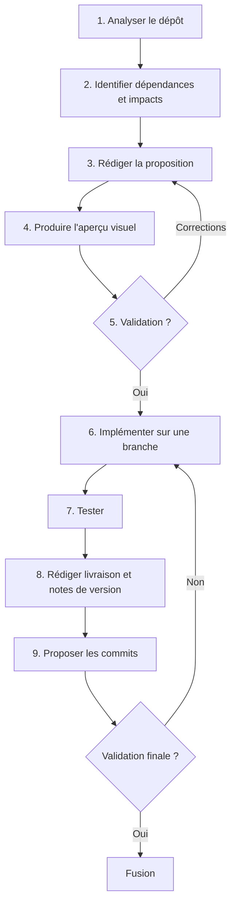

# 06 — Méthode de travail

## Règle centrale

Aucune fonctionnalité significative n'est codée sans proposition écrite, aperçu visuel et validation explicite dans la conversation. « Significative » : tout ce qui ajoute ou modifie un comportement visible, une structure de données ou une dépendance. Les corrections de bug évidentes et les retouches de documentation en sont dispensées.

## Cycle d'une fonctionnalité

| Étape | Livrable | Modèle |
|---|---|---|
| 3 | Proposition : besoin, solution, impacts, alternatives, risques, plan de test | [proposition](modeles/proposition-fonctionnalite.md) |
| 4 | Aperçu : maquette, schéma ou capture selon la nature du changement | — |
| 8 | Livraison : résumé, impact technique, risques, tests réalisés, résultats de performance | [livraison](modeles/livraison-fonctionnalite.md) |
| 8 | Entrée de journal des modifications | [notes de version](modeles/notes-de-version.md) |

Les deux points d'arrêt (étapes 5 et 10) sont obligatoires. Entre les deux, le travail avance sans interruption.

## Rôles des agents

Chaque rôle est un point de vue à appliquer, pas forcément un agent lancé séparément. Les définitions utilisables par Claude Code sont dans [.claude/agents/](../.claude/agents/).

| Rôle | Responsabilité | Intervient |
|---|---|---|
| Architecte | Découpage en modules, dépendances, ADR, cohérence d'ensemble | Proposition ; revue de tout changement de structure |
| Designer UI/UX | Maquettes, système visuel, parcours utilisateur | Aperçu ; revue de tout changement visible |
| Ingénieur vidéo | Décodage, compositeur, effets, export, audio | Proposition et implémentation du moteur |
| Performance | Budgets, mesures, profils, régressions | Avant et après chaque fonctionnalité du moteur ou de la timeline |
| Qualité | Plan de test, tests automatiques, non-régression | Proposition (plan) ; livraison (résultats) |
| Sécurité | Isolation, validation des fichiers tiers, dépendances, mises à jour | Toute fonctionnalité qui lit un fichier externe ou télécharge |
| Git/GitHub | Branches, commits, releases, intégration continue | Fin de cycle |
| Documentation | Mise à jour des documents, ADR, journal des modifications | Fin de cycle |
| Test utilisateur | Parcourt la fonctionnalité comme un débutant, relève les frictions | Avant la validation finale |

## Définition de « terminé »

Une fonctionnalité est terminée quand :

- [ ] elle correspond à la proposition validée, ou les écarts sont signalés ;
- [ ] les tests automatiques passent, y compris ceux des fonctionnalités existantes ;
- [ ] les budgets de performance concernés sont mesurés et tenus ([07](07-tests.md)) ;
- [ ] l'interface a été vérifiée dans les deux thèmes et aux trois échelles d'affichage ;
- [ ] le compte rendu de livraison est rédigé avec ses cinq rubriques ;
- [ ] le journal des modifications est à jour ;
- [ ] la documentation touchée est à jour ;
- [ ] les problèmes connus sont listés, pas cachés.

## Décisions

- Toute décision qui engage durablement (dépendance, format de fichier, licence, structure) fait l'objet d'un ADR dans [docs/adr/](adr/README.md).
- Un ADR accepté ne se modifie pas : on en écrit un nouveau qui le remplace.

## Communication

- Les comptes rendus disent ce qui a été fait, ce qui ne l'a pas été, et ce qui a échoué, avec les sorties de test à l'appui.
- Les choix de conception sont toujours expliqués, avec l'alternative écartée.
- En cas de doute entre maintenabilité, performance et expérience utilisateur d'un côté, rapidité de livraison de l'autre : les trois premières l'emportent.
