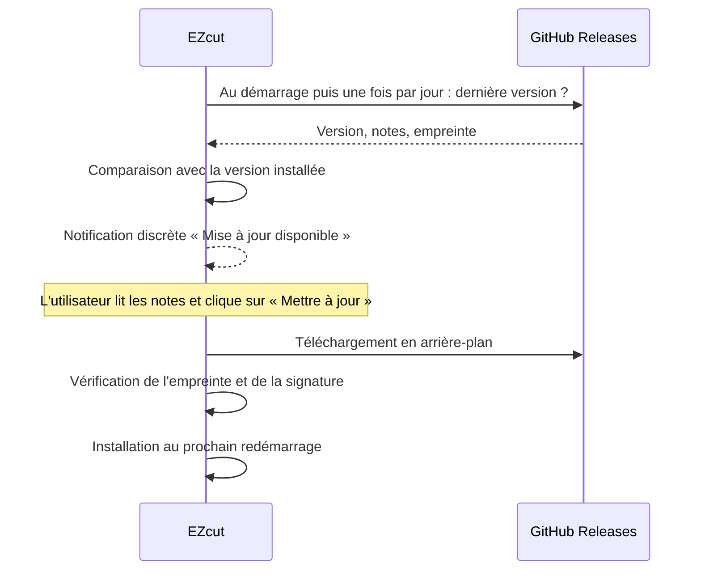

# 08 — Versions, releases et mises à jour

## Branches

| Branche | Rôle | Règle |
|---|---|---|
| `main` | Toujours stable et publiable | Protégée ; modification par pull request uniquement ; intégration continue verte obligatoire |
| `feat/<sujet>` | Une fonctionnalité | Courte durée ; créée après validation de la proposition |
| `fix/<sujet>` | Une correction | |
| `docs/<sujet>`, `chore/<sujet>` | Documentation, outillage | |
| `spike/<sujet>` | Prototype de la phase 0 | Jamais fusionnée ; seul le compte rendu rejoint `main` |

Pas de branche `develop` : une seule branche longue, des branches de travail courtes.

## Messages de commit

Format Conventional Commits : `type(module): description`.

| Type | Usage | Rubrique des notes de version |
|---|---|---|
| `feat` | Nouvelle fonctionnalité | Nouveautés |
| `perf`, `refactor` visible | Amélioration | Améliorations |
| `fix` | Correction | Corrections |
| `docs`, `test`, `chore`, `ci` | Interne | Non affiché |

Un commit = un changement cohérent qui laisse le projet dans un état fonctionnel.

## Numéros de version

Versionnage sémantique `MAJEUR.MINEUR.CORRECTIF`. Avant la 1.0, chaque version mineure correspond à une étape de la [feuille de route](03-roadmap.md).

Deux canaux : **stable** (par défaut) et **bêta** (versions `-beta.N`, sur activation dans les réglages).

## Processus de release

1. Tous les critères de sortie de la version sont atteints.
2. Le journal des modifications est finalisé ; la rubrique « Problèmes connus » est rédigée à la main.
3. Une étiquette `vX.Y.Z` est posée sur `main`.
4. L'intégration continue construit l'installateur, calcule les empreintes et crée la release GitHub avec les notes de version.
5. Test d'installation et de mise à jour depuis la version précédente sur une machine propre.
6. Publication de la release.

## Journal des modifications et notes de version

- [CHANGELOG.md](../CHANGELOG.md) est la source unique. Il est généré à partir des commits puis relu.
- Quatre rubriques : Nouveautés, Améliorations, Corrections, Problèmes connus.
- Rédigé pour l'utilisateur : ce qui change pour lui, pas le détail technique.
- Le texte de la release GitHub est la section correspondante du journal.

## Mise à jour automatique

- La vérification ne bloque jamais le démarrage et échoue en silence hors ligne.
- Jamais d'installation sans action de l'utilisateur ; jamais pendant un export.
- Le projet ouvert est sauvegardé avant le redémarrage.
- Désactivable dans les réglages.

## Notes de version dans le logiciel

- Après une mise à jour, un panneau « Quoi de neuf » s'affiche une fois, avec les quatre rubriques.
- L'historique complet reste accessible depuis le menu Aide.
- Le contenu vient des releases GitHub, avec une copie embarquée pour l'usage hors ligne.

## Signature du code

Un installateur non signé déclenche l'avertissement SmartScreen de Windows et réduit la confiance dans les mises à jour. Une signature demande un certificat payant et une identité vérifiée. Décision D5 : les versions bêta sont distribuées non signées avec une mention explicite ; la signature commence à la première version publique.

## Intégration continue

| Déclencheur | Vérifications |
|---|---|
| Pull request | Analyse statique, types, tests unitaires, rendu de référence, intégration, interface, audit des dépendances |
| Fusion sur `main` | Les mêmes, plus construction de l'installateur |
| Étiquette de version | Construction, empreintes, signature, création de la release |
