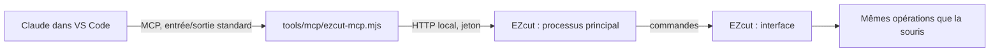

# 09 — Lien avec Claude et journal

## À quoi ça sert

EZcut peut être piloté par Claude : vous décrivez le montage voulu dans VS Code, Claude l'exécute dans la fenêtre d'EZcut ouverte à côté. Il importe les fichiers, pose les clips, les titres, les effets et les transitions, regarde le résultat, corrige, exporte. Chaque modification apparaît en direct et s'annule avec `Ctrl` + `Z`.

## Mise en route

1. Dans EZcut, bouton **Claude** en haut à droite → activer le lien. Le réglage est conservé.
2. Dans VS Code, ouvrir le dossier du projet EZcut avec Claude Code. Le serveur `ezcut` est déclaré dans [.mcp.json](../.mcp.json) : l'accepter quand Claude Code le propose.
3. Demander, par exemple : « Importe les trois vidéos de `D:\Vacances`, monte-les dans l'ordre, ajoute un titre au début et exporte en 1080p. »

Depuis un autre dossier, ou avec un autre client MCP, déclarer le serveur une fois :

```
claude mcp add ezcut -- node chemin/vers/EZcut/tools/mcp/ezcut-mcp.mjs
```

## Comment c'est fait



- [tools/mcp/ezcut-mcp.mjs](../tools/mcp/ezcut-mcp.mjs) : serveur MCP sans dépendance. Il ne contient ni clé ni donnée personnelle ; il lit le port et le jeton qu'EZcut écrit dans son dossier de données.
- [electron/control.cjs](../electron/control.cjs) : serveur local d'EZcut. Les commandes qui touchent aux fichiers (import, export, enregistrement) sont traitées par le processus principal, les autres par l'interface ([src/ui/control.ts](../src/ui/control.ts)).
- Chaque commande passe par les opérations de `core`, puis le projet obtenu est revalidé comme un fichier venu de l'extérieur : une valeur absurde est bornée, jamais propagée.

## Outils disponibles

| Outil | Rôle |
|---|---|
| `ezcut_status` | État du projet : médias, pistes de haut en bas (`trackOrder`), clips de chaque piste, tête de lecture |
| `ezcut_catalog` | Effets, filtres, transitions et modèles de titres, avec leurs réglages |
| `ezcut_import`, `ezcut_media_preview` | Importer des fichiers ; voir une planche d'images d'un média |
| `ezcut_add_clip`, `ezcut_add_title` | Poser un média (piste principale, par-dessus, son, musique, ou une piste ajoutée désignée par son identifiant), un titre |
| `ezcut_edit_clip`, `ezcut_split`, `ezcut_remove_clip` | Rogner, déplacer (dans le temps, ou vers une autre piste du même genre avec `track`), régler, couper, retirer |
| `ezcut_apply_effect`, `ezcut_edit_effect`, `ezcut_set_transition` | Effets, filtres, transitions |
| `ezcut_marker`, `ezcut_track` | Repères de la timeline ; piste muette, masquée, verrouillée ; ajouter une piste (`action: add`, `kind`), la supprimer (`remove`), la changer de rang (`move`, `delta`) |
| `ezcut_project`, `ezcut_transport` | Format du projet ; tête de lecture, lecture |
| `ezcut_screenshot` | Image du montage tel qu'il sera exporté |
| `ezcut_undo`, `ezcut_redo` | Annuler, rétablir |
| `ezcut_save`, `ezcut_open`, `ezcut_new`, `ezcut_export` | Projet et export |
| `ezcut_logs` | Journal de l'application |

## Sécurité et vie privée

- Le lien est **désactivé par défaut**. Tant qu'il l'est, rien n'écoute.
- Activé, il n'écoute que sur `127.0.0.1`, sur un port et avec un jeton tirés au hasard à chaque lancement. Une requête sans jeton, ou venant d'une page web, est refusée.
- Port et jeton sont écrits dans le dossier de données d'EZcut (`%APPDATA%\ezcut\control.json`), supprimé à la fermeture. Tout programme lancé sous votre compte Windows peut le lire : le lien vous protège d'Internet et des autres comptes, pas d'un logiciel malveillant déjà installé chez vous.
- Par le lien, l'assistant peut : lire les fichiers média dont il donne le chemin, écrire une vidéo `.mp4` ou un projet `.ezcut` là où il l'indique. Il ne peut pas écraser une vidéo existante sans le demander explicitement, ni écrire un autre type de fichier, ni utiliser un chemin réseau. Ouvrir ou créer un projet par-dessus des modifications non enregistrées vous demande confirmation.
- EZcut n'envoie rien sur Internet. Les images que Claude regarde (planches de vos médias, captures du montage) lui sont transmises par votre client Claude, comme tout ce que vous lui montrez.
- Ce dépôt est public : il ne contient aucun chemin, nom ou identifiant personnel, et le lien n'en ajoute pas.

## Journal

EZcut tient un journal dans `%APPDATA%\ezcut\logs\ezcut.log` (2 Mo, puis `ezcut.1.log`). On y trouve :

- le démarrage : version, système, FFmpeg trouvé ou non, encodeurs matériels ;
- les erreurs de l'interface, avec leur pile d'appels ;
- les effets qui ne compilent pas, les médias illisibles, les fichiers refusés à l'import ;
- chaque export : paramètres, durée, et en cas d'échec la commande FFmpeg et son message ;
- les commandes reçues par le lien.

Le journal reste sur votre machine et contient des chemins de fichiers : relisez-le avant de le publier dans un rapport de bug. Pour l'ouvrir : bouton **Claude** → « Ouvrir le journal ». Claude le lit avec `ezcut_logs`, même si l'application est fermée ou a planté.

## Vérification

`npm run test:link` lance la vraie application avec un dossier de données à part et la pilote uniquement à travers le serveur MCP : import, montage, titre, logo, filtre, transition, annulation, capture, enregistrement, export, refus d'accès sans jeton.
